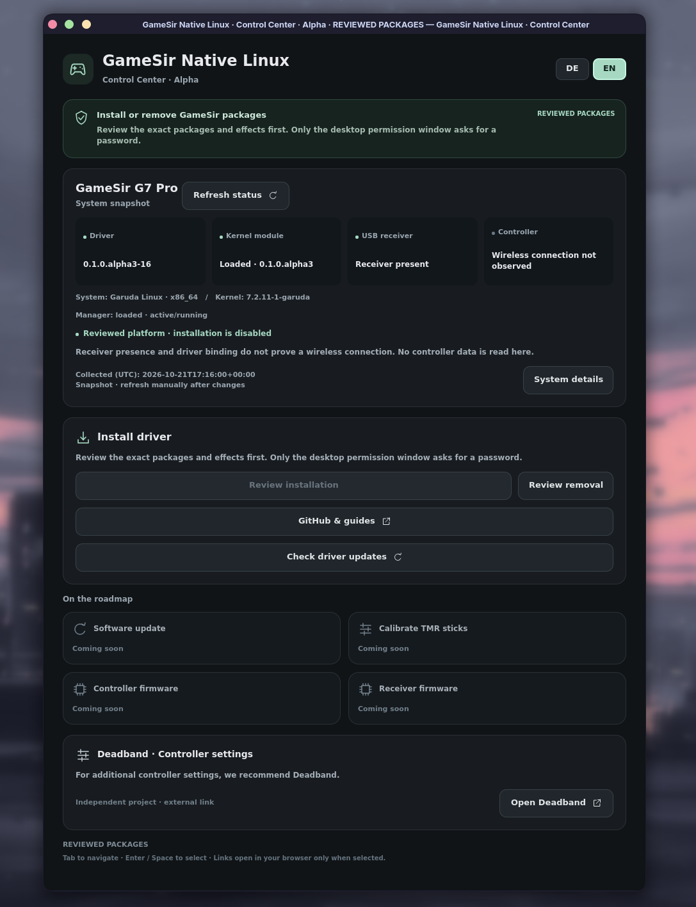

# GameSir Native Linux

> ⚠️ **PRE-ALPHA — experimental software.** For experienced Linux users.
> Crashes, freezes and data loss are possible. Do not use on critical systems.

Read the full warning

⚠️ **WARNING: EXPERIMENTAL SOFTWARE**

This project is in a **PRE-ALPHA** development stage.

Intended exclusively for experienced Linux users and developers with a solid understanding of kernel modules, system recovery and debugging.

The driver is incomplete, has not undergone comprehensive hardware validation and may cause:

- Kernel crashes, freezes or boot failures
- USB/HID driver conflicts and device malfunctions
- Data loss or system instability
- Unexpected behavior after kernel updates

**DO NOT use on production-critical systems.**

Installation and use are entirely at your own risk.

No stability, compatibility or safety guarantees are provided.

GameSir Native Linux brings the G7 Pro's extra buttons, motion controls and
vibration features to Linux. It started because I wanted to use my own controller
without missing out on its features.

The project includes a driver and the **GameSir Control Center**, a desktop app
for checking status and managing installation, in German and English.

  

*Control Center with real system status. Available actions depend on your system.*

## Features

- **Normal gamepad controls** — buttons, sticks, triggers and D-pad.
- **Four independent extra buttons** — assign L4, R4, L5 and R5 separately.
- **Motion controls** — use controller movement in Eden and through Steam Input.
  This feature is experimental and needs separate setup.
- **Vibration** — grip rumble and independent control of both trigger motors.
  Trigger effects need additional game support; see the limitations below.
- **Controller detection** — the driver waits for your wireless controller
  to connect. Some reconnect problems remain under investigation.
- **Control Center** — system status, installation, removal and driver-update checks.
- **Optional stick calibration** — guided calibration for the G7 Pro and ZZZ,
  with live stick displays. Requires [additional TMR setup](docs/TMR_SETUP.md).

## Acknowledgements / Special Thanks

A special thank you to the developer of
**[Deadband](https://github.com/broroeror/gamesir-linux-tools)**.
Your work on GameSir configuration, gyroscope support and trigger vibration
gave this project a valuable starting point. Getting this far would have been
much harder without it. For additional controller settings, take a look at Deadband.

Thanks also to **[g7ctl](https://github.com/questionablesyntax/g7ctl)** for the open
research and documentation of GameSir G7 protocols.

These independent projects were technical references for our work.

## Supported hardware and systems

Support currently focuses on the **2.4 GHz USB receiver**.

| Hardware / system | Current scope |
| --- | --- |
| GameSir G7 Pro | Main development and testing device. |
| G7 Pro Zenless Zone Zero Edition | Experimental input, motion and stick-calibration support with scoped test results. |
| Garuda Linux with KDE Plasma | Driver and Control Center tested. |
| CachyOS Handheld Edition with Gamescope | Driver tested; use the manual installation guide. |

Other controllers, connection modes and distributions have not been validated.

**Current release:** [PRE-ALPHA.4](https://github.com/RetroGamerGER/gamesir-native-linux/releases/tag/v0.1.0-pre-alpha.4),
with driver `0.1.0.alpha3-20` and Control Center `0.1.0.alpha2`.

## Installation

The current Control Center download is for **64-bit Garuda Linux**.
Read the [requirements](docs/CONTROL_CENTER_DISTRIBUTION.md) and
[installation guide](docs/INSTALLATION.md), and close games and Deadband first.

1. Download the **Control Center `.AppImage`** from the
   [GitHub release](https://github.com/RetroGamerGER/gamesir-native-linux/releases/tag/v0.1.0-pre-alpha.4).
2. Make it executable in your file manager and open it as your normal user.
3. If offered, choose **Set up helper** and review the request. Enter your
   password only in the system's password window.
4. Choose **Check driver updates** to load the current signed package list.
5. Choose **Review installation**, select the components you need and confirm
   the plan when the app's checks pass.
6. Follow the [activation and verification steps](docs/INSTALLATION.md#4-enable-normal-automatic-operation).
   Installing packages and enabling the driver are separate steps.

The app downloads checked packages from our GitHub releases. Compatible driver
updates can be checked in the app without downloading a new AppImage each time.

For manual installation, CachyOS setup or complete removal, follow the
[installation guide](docs/INSTALLATION.md).

## Known limitations

- After a long time switched off or after reconnecting, a controller may fail
  to be detected, or some buttons may stop working. We are investigating.
- Motion support is experimental; precise calibration is not complete.
  Steam's gyro display can stay at zero even when motion works in a game.
- **Eden in Gaming Mode** may need a
  [manual launch adjustment](docs/SDL_EDEN_GYRO.md#manual-steps-for-the-tested-launcher-shape)
  to see the real controller and its motion sensors.
- **Trigger vibration** has been confirmed with Forza Horizon 6 through Xodus
  Nexus. General Steam/Proton game support is not confirmed.
- Stick calibration requires the optional helper and explicit setup; the
  normal driver installation leaves it disabled. See [TMR setup](docs/TMR_SETUP.md).
- Firmware updates remain planned.

## Documentation

[Installation, recovery and removal](docs/INSTALLATION.md) ·
[Motion controls and Eden](docs/SDL_EDEN_GYRO.md) ·
[Trigger vibration](docs/TRIGGER_BRIDGE.md) · [Roadmap](docs/ROADMAP.md)

For developers: [Architecture](docs/ARCHITECTURE.md) ·
[Build and tests](docs/TESTING.md) · [Tested scope and release notes](docs/RELEASE_AUDIT.md)

## Project Goals

Our goal is to provide native, community-driven Linux support for GameSir controllers, including advanced features that are often unavailable through generic Xbox-compatible drivers.

The long-term ambition is to develop maintainable, upstream-quality support suitable for consideration in the Linux kernel.

## License

**GNU GPL Version 2 only (`GPL-2.0-only`)** — see [COPYING](COPYING).
Third-party notices and the existing
[Linux UAPI exception](LICENSES/exceptions/Linux-syscall-note) remain in place.
[Licensing and source credits](docs/LICENSING.md).
